# Lab 4 : Auto-encodeurs, VAE et GANs (IA générative)

**Module :** Deep Learning, cycle LSI, FST Tanger
**Auteure :** Ikrame Houzane
**Outils :** PyTorch, Google Colab (GPU Tesla T4), GitHub
**Notebook :** [`Lab4_final.ipynb`](Lab4_final.ipynb) (toutes les cellules sont exécutées, les sorties sont conservées)

---

## 1. Objectif

Se familiariser avec PyTorch et construire trois familles de modèles génératifs :

1. un **auto-encodeur (AE)** et un **auto-encodeur variationnel (VAE)** entraînés sur **MNIST** ;
2. un **GAN** (réseau antagoniste génératif) entraîné sur le dataset **Abstract Art Gallery**.

## 2. Structure du dépôt

```
.
├── README.md        # ce rapport
├── Lab4.ipynb       # notebook complet (code, sorties, observations)
└── images/          # figures générées par le notebook
```

## 3. Correspondance avec le sujet

| Question du sujet | Où la trouver |
|---|---|
| P1-Q1 : Architecture AE + entraînement + meilleurs hyperparamètres | Notebook §1.1 à §1.5 ; README §4.1 |
| P1-Q2 : Architecture VAE + entraînement + meilleurs hyperparamètres | Notebook §2.1 à §2.5 ; README §4.2 |
| P1-Q3 : Évaluation par courbes (loss, KL divergence) et conclusion | Notebook §1.3, §2.3, §3 ; README §4.3 |
| P1-Q4 : Espace latent des deux modèles | Notebook §4 ; README §4.4 |
| P2-Q1 : Générateur, discriminateur, loss, initialisation, GPU, DataLoader, optimiseurs, entraînement | Notebook §5 à §7 ; README §5.1 à §5.3 |
| P2-Q2 : Évaluation par courbes (générateur et discriminateur) | Notebook §8.1 ; README §5.4 |
| P2-Q3 : Génération de nouvelles données et comparaison aux originales | Notebook §8.2, §8.3 ; README §5.5 |
| Synthèse personnelle | Notebook (dernière cellule) ; README §6 |

---

## 4. Partie 1 : AE et VAE sur MNIST

**Données :** MNIST, 60 000 images d'entraînement et 10 000 images de test (28×28, niveaux de gris, pixels dans [0, 1]), chargé via `torchvision`. DataLoader avec des lots de 128 images.

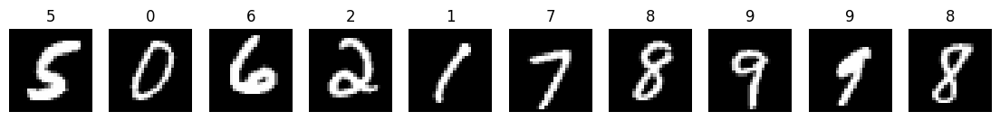

### 4.1 Auto-encodeur (AE)

**Architecture** (perceptron multicouche) :

| Bloc | Couches |
|---|---|
| Encodeur | Flatten → Linear(784, 256) → ReLU → Linear(256, 64) → ReLU → Linear(64, `latent`) |
| Décodeur | Linear(`latent`, 64) → ReLU → Linear(64, 256) → ReLU → Linear(256, 784) → Sigmoid |

- **Perte :** MSE entre l'image et sa reconstruction.
- **Optimiseur :** Adam. Entraînement évalué à chaque epoch sur le jeu de test.

**Recherche des hyperparamètres** (10 epochs par essai, loss de test) :

| Dimension latente | Learning rate | Loss test |
|---|---|---|
| 2 | 1e-3 | 0.0387 |
| 8 | 1e-3 | 0.0190 |
| **16** | **1e-3** | **0.0124** |
| 16 | 1e-2 | 0.0140 |
| 16 | 1e-4 | 0.0254 |

**Hyperparamètres retenus :** `latent = 16`, `learning rate = 1e-3`, `batch size = 128`, `epochs = 20`, optimiseur Adam.

- La **dimension latente** est le facteur le plus influent : la loss est divisée par plus de 3 entre `latent = 2` et `latent = 16`.
- Un learning rate de 1e-4 converge trop lentement en 10 epochs, et 1e-2 est un peu moins précis que 1e-3.

**Résultats :** AE final (`latent = 16`) : loss de test **0.0103**, contre **0.0373** pour l'AE à `latent = 2` (20 epochs). Train et test restent proches : pas de sur-apprentissage.

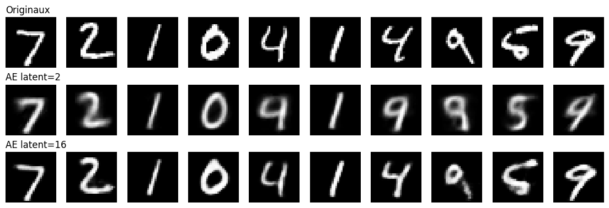

Avec `latent = 2`, les chiffres proches (4, 9, 5) sont tous reconstruits en « 9 » flou, car toute l'information tient en 2 nombres. Avec `latent = 16`, ils sont correctement distingués.

### 4.2 Auto-encodeur variationnel (VAE)

**Architecture :** même squelette que l'AE, mais l'encodeur produit **deux vecteurs**, `mu` (moyenne) et `logvar` (log-variance), puis on échantillonne par **reparamétrisation** : `z = mu + sigma × epsilon`, avec `epsilon ~ N(0, 1)`.

**Fonction de perte :** `L = reconstruction + β × KL`

- reconstruction : entropie croisée binaire, sommée sur les 784 pixels ;
- KL divergence : `-0.5 × Σ(1 + logvar - mu² - exp(logvar))`, qui rapproche la distribution latente de N(0, 1).

**Recherche des hyperparamètres** (10 epochs par essai) :

| Dimension latente | Learning rate | β | Reconstruction test | KL test | Loss test |
|---|---|---|---|---|---|
| 2 | 1e-3 | 1 | 141.80 | 6.05 | 147.85 |
| 8 | 1e-3 | 1 | 96.59 | 15.82 | 112.42 |
| **16** | **1e-3** | **1** | **90.64** | 18.38 | **109.01** |
| 16 | 1e-3 | 4 | 117.18 | 7.83 | 148.51 |
| 16 | 1e-2 | 1 | 120.68 | 11.57 | 132.25 |

(On compare la reconstruction et non la loss totale, car β change le poids de la KL.)

**Hyperparamètres retenus :** `latent = 16`, `learning rate = 1e-3`, `β = 1`, `batch size = 128`, `epochs = 20`, optimiseur Adam.

- Passer de 2 à 16 dimensions améliore la reconstruction, et la KL augmente puisque le modèle encode davantage d'information.
- Un `β` élevé (4) régularise plus fortement : KL plus faible mais reconstruction dégradée.
- Contrairement à l'AE, un learning rate de 1e-2 est nettement moins bon que 1e-3 pour le VAE (instabilité).

**Résultats :** VAE final (`latent = 16`) : loss de test **105.82** (reconstruction ≈ 87, KL ≈ 19), contre 144.50 pour `latent = 2`.

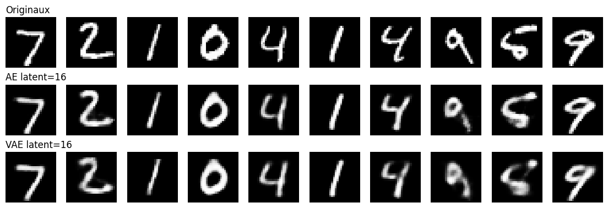

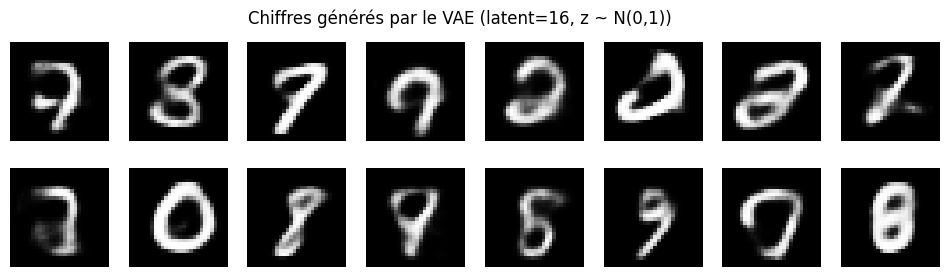

Les chiffres tirés au hasard dans N(0, 1) sont en partie lisibles, mais plusieurs sont ambigus ou mal formés. Ils n'existent pas dans MNIST : le VAE est un vrai modèle génératif.

### 4.3 Évaluation : courbes et conclusion (AE vs VAE)

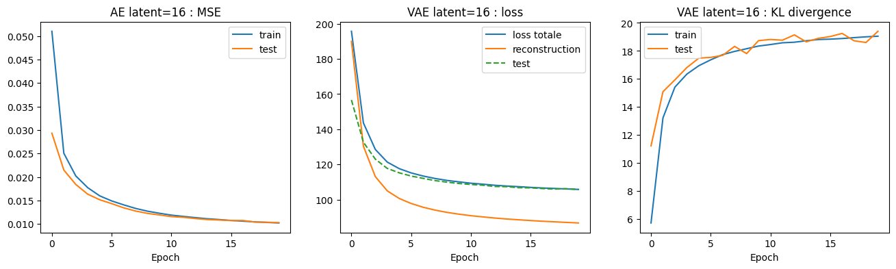

- **AE :** la MSE passe d'environ 0.051 à 0.010 et se stabilise. Les courbes train et test se superposent à la fin.
- **VAE :** la loss totale passe d'environ 196 à 106 et la reconstruction descend jusqu'à environ 87, sans sur-apprentissage.
- **KL divergence :** elle **augmente** (≈ 6 → 19) puis se stabilise. Au début, l'encodeur est proche de N(0, 1) mais reconstruit mal. Il apprend ensuite à encoder de l'information dans `z`, ce qui coûte de la KL : c'est le **compromis reconstruction / régularisation**.

**Conclusion.**

- L'AE reconstruit plus fidèlement (images plus nettes), car il n'optimise que la reconstruction.
- Le VAE reconstruit des images légèrement plus floues, mais son espace latent est régularisé : on peut y tirer `z` au hasard et **générer** de nouvelles données, ce que l'AE ne sait pas faire proprement.
- Augmenter la dimension latente (2 → 16) améliore nettement les deux modèles.

### 4.4 Espace latent (modèles à `latent = 2`)

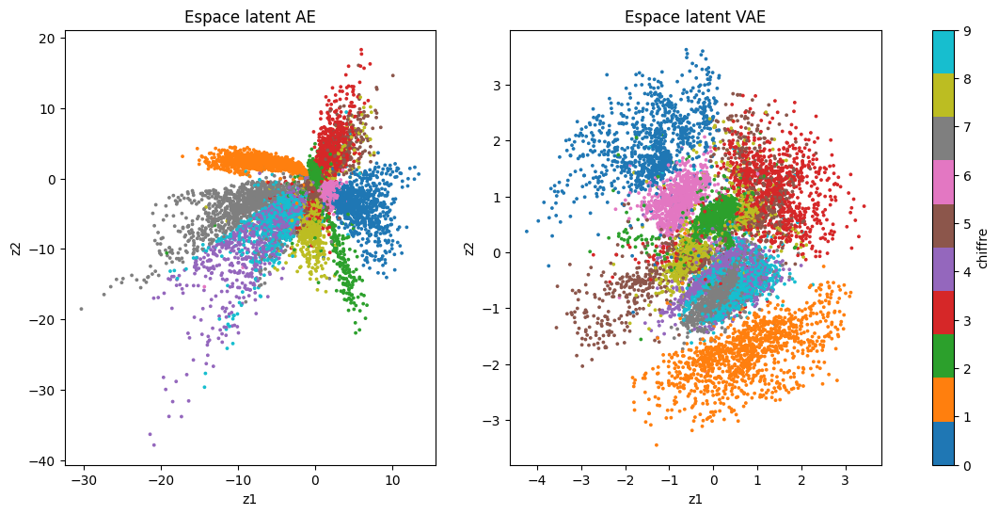

- **AE :** espace très étalé et non centré (z1 d'environ -30 à +14, z2 d'environ -40 à +18). Les classes forment des branches allongées issues d'un centre très dense, où plusieurs chiffres (4, 7, 9) se chevauchent. Les zones entre les branches sont vides.
- **VAE :** nuage **compact et centré** près de (0, 0) (z1 entre -4 et 3, z2 entre -3.5 et 3.5), effet direct de la KL. Les classes se touchent sans grands vides, avec un chevauchement résiduel pour les chiffres proches (4/7/9, 5/8), normal avec 2 dimensions.

Décodage d'une grille 15×15 de points du plan latent :

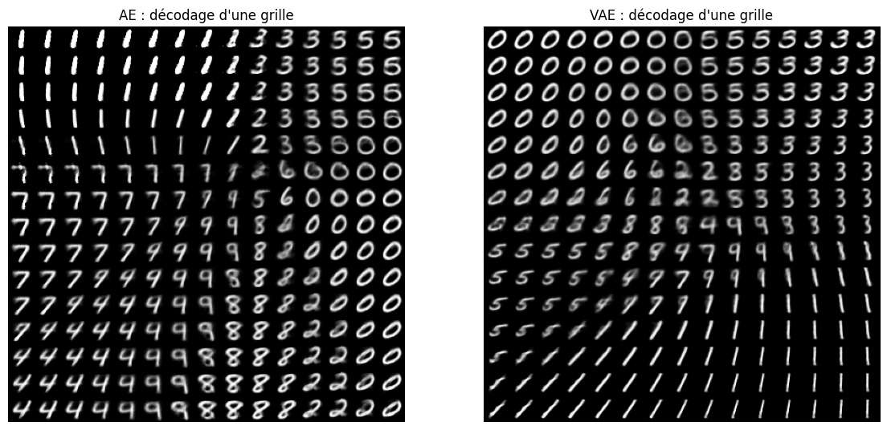

- **AE :** transitions brusques entre chiffres et zone centrale floue et ambiguë : le décodeur ne sait pas quoi produire entre les amas.
- **VAE :** transitions **continues et progressives** d'un chiffre à l'autre (par exemple 0 → 5 → 3 en haut). Tout point proche de (0, 0) décode un chiffre plausible.

---

## 5. Partie 2 : GAN sur Abstract Art Gallery

### 5.1 Données

- Dataset Kaggle [`bryanb/abstract-art-gallery`](https://www.kaggle.com/datasets/bryanb/abstract-art-gallery) : **2 872 images** d'art abstrait.
- Prétraitement : recadrage carré au centre, redimensionnement en **64×64 RGB**, normalisation dans **[-1, 1]** (sortie `Tanh` du générateur).
- Les images sont prétraitées **une seule fois** (22 s) et conservées **sur le GPU** : l'entraînement passe d'environ 47 s à environ 4 s par epoch.

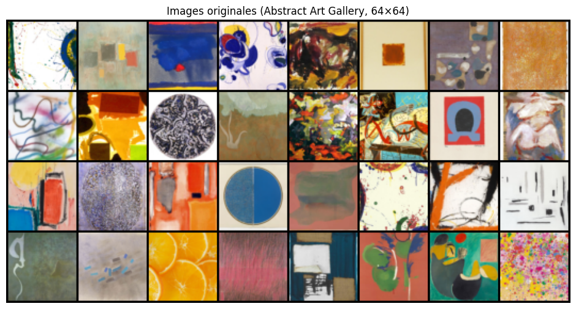

### 5.2 Architecture (DCGAN)

| Réseau | Description |
|---|---|
| **Générateur G** (3 576 704 paramètres) | bruit `z` de 100 valeurs → ConvTranspose2d (1×1 → 4×4 → 8×8 → 16×16 → 32×32 → 64×64), BatchNorm + ReLU, sortie `Tanh` |
| **Discriminateur D** (2 765 568 paramètres) | Conv2d (64 → 32 → 16 → 8 → 4 → 1), BatchNorm + LeakyReLU(0.2), sortie : un logit |

### 5.3 Configuration d'entraînement

| Élément | Choix |
|---|---|
| Initialisation | N(0, 0.02) pour les convolutions, N(1, 0.02) pour BatchNorm |
| GPU | G et D envoyés sur `cuda` (Tesla T4) |
| Fonction de perte | `BCEWithLogitsLoss` (D : vrai → 1, faux → 0 ; G : tromper D) |
| Optimiseurs | Adam, lr = 2e-4, β1 = 0.5 (un par réseau) |
| Batch size | 64 |
| Epochs | 150 (≈ 570 s au total) |

À chaque itération : (1) mise à jour de D sur un lot de vraies images et un lot de fausses images (`detach()` pour ne pas toucher G) ; (2) mise à jour de G pour que D classe ses images comme vraies. Un bruit fixe permet de suivre l'évolution visuelle de G.

### 5.4 Évaluation : courbes

> **Remarque :** la KL divergence est propre au VAE et n'existe pas dans un GAN classique. On évalue donc le GAN avec les loss de G et D, et les sorties du discriminateur `D(x)` (vraies images) et `D(G(z))` (fausses images).

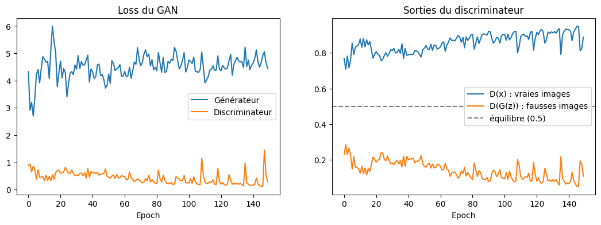

- La loss de G reste stable autour de 4.5 pendant les 150 epochs : pas de divergence ni d'effondrement.
- `D(x)` passe de 0.77 à environ 0.9 et `D(G(z))` de 0.23 à environ 0.1 : le discriminateur prend progressivement l'avantage sans empêcher G d'apprendre. L'équilibre théorique (0.5) n'est pas atteint.
- La loss d'un GAN ne mesure pas la qualité des images (les deux réseaux évoluent ensemble) : l'évaluation visuelle est indispensable.

### 5.5 Génération et comparaison avec les images originales

Évolution des images générées (même bruit fixe) :

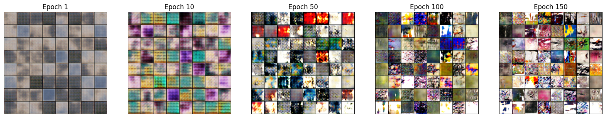

Images originales (gauche) contre images générées (droite) :

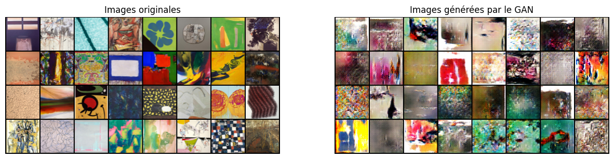

- **Points forts :** le GAN reproduit les palettes de couleurs et les textures globales de l'art abstrait, avec une bonne diversité (pas de *mode collapse*).
- **Limites :** les formes nettes et structurées des originales (cercles, aplats, motifs géométriques) sont absentes. Les images générées présentent du bruit haute fréquence et des motifs répétitifs.
- **Causes probables :** dataset petit (2 872 images), faible résolution (64×64), architecture DCGAN simple et discriminateur qui domine en fin d'entraînement.
- **Pistes d'amélioration :** plus d'epochs, label smoothing, augmentation de données, architectures plus avancées (WGAN-GP, StyleGAN).

---

## 6. Synthèse personnelle

Dans ce lab, j'ai appris à construire avec PyTorch trois familles de modèles génératifs.

- **Auto-encodeur :** compression puis reconstruction. La dimension de l'espace latent détermine la qualité (loss de test 0.037 avec 2 dimensions, 0.010 avec 16), mais son espace latent est irrégulier et ne permet pas de générer proprement.
- **VAE :** l'encodeur produit une distribution, et la KL divergence régularise l'espace latent. J'ai compris le compromis reconstruction / régularisation (rôle de β) : on perd un peu en netteté, mais on gagne un espace continu et centré qui permet de générer de nouvelles images.
- **GAN :** deux réseaux en compétition. L'entraînement est plus délicat : la loss ne reflète pas la qualité et il faut surveiller `D(x)` et `D(G(z))` ainsi que les images générées.
- **Difficultés rencontrées :** un entraînement du GAN très lent à cause du chargement des images à chaque epoch (47 s par epoch). Je l'ai résolu en prétraitant le dataset une seule fois et en le gardant sur le GPU (environ 4 s par epoch).

## 7. Reproduire les résultats

1. Ouvrir `Lab4.ipynb` dans [Google Colab](https://colab.research.google.com) (**Fichier → Importer un notebook**).
2. Activer le GPU : **Exécution → Modifier le type d'exécution → T4 GPU**.
3. Exécuter toutes les cellules dans l'ordre. MNIST est téléchargé automatiquement ; le dataset Abstract Art Gallery l'est via `kagglehub`.
4. Durée approximative : environ 10 minutes pour la partie 1, environ 10 minutes pour l'entraînement du GAN.

Les valeurs peuvent varier légèrement d'une exécution à l'autre (initialisation aléatoire).
